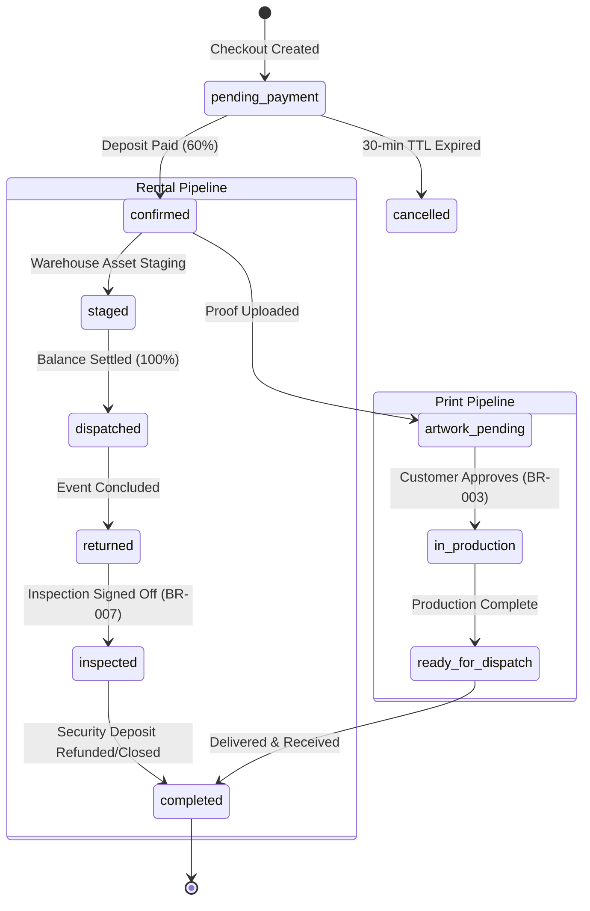
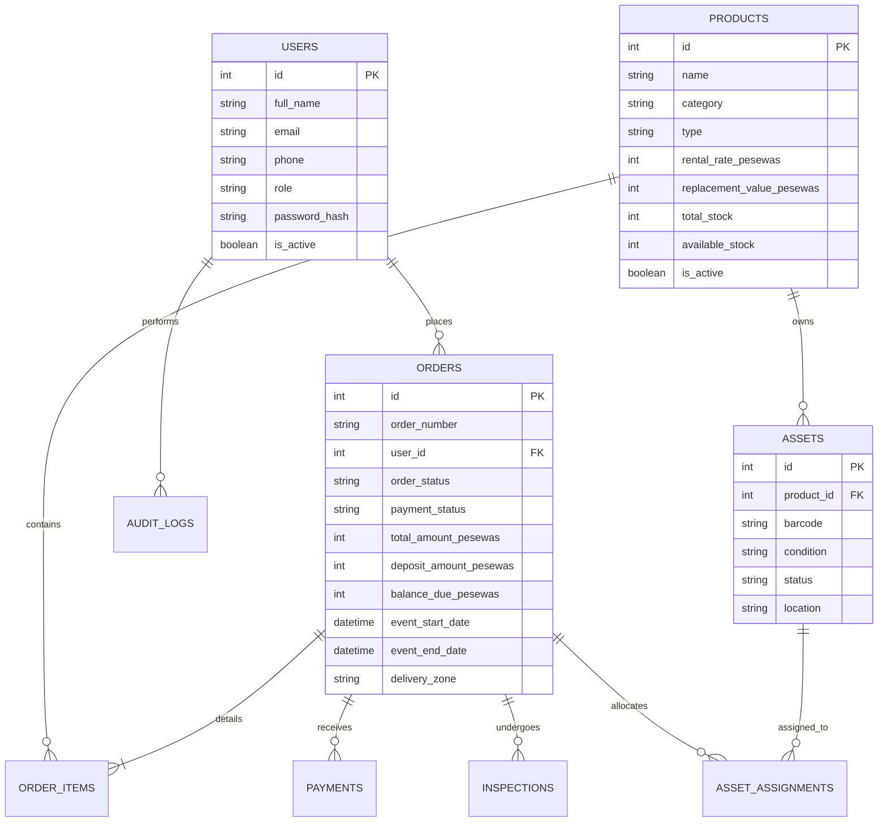

# BOLDDEE RENTALS - Architecture Documentation

## 1. System Overview

BOLDDEE RENTALS is a dual-vertical web application serving Ghanaian event planners, corporate organizers, and retail customers with:
1. **Event Equipment Rentals** (canopies, chairs, luxury sofa sets, tables, sound/lighting gear, generators)
2. **Custom Print & Branding Services** (banners, step-and-repeat backdrops, branded keepsakes)

The platform is architected for deployment in Ghana with offline-first resilience, mobile money checkout via Paystack, automated WhatsApp/SMS dispatch, barcode-based asset management, and strict regulatory compliance (Ghana Data Protection Act 2012, Act 843).

```
                      +---------------------------------------+
                      |         Client Web Applications       |
                      |  React 18 + Vite SPA (Customer/Admin) |
                      +-------------------+-------------------+
                                          |
                                          | HTTPS / REST (JSON)
                                          v
                      +---------------------------------------+
                      |       Node.js / Express API Layer     |
                      |   - Auth & RBAC Middleware            |
                      |   - Pricing Engine (Integer Pesewas)  |
                      |   - Availability Engine (Buffers)     |
                      |   - State Machine (BR-003 / BR-007)   |
                      |   - Automated Scheduler (Holds/TTL)   |
                      +---------+-------------------+---------+
                                |                   |
             +------------------+                   +------------------+
             |                                                         |
             v                                                         v
+---------------------------+                             +---------------------------+
|    SQLite Database (WAL)  |                             |     External Integrations |
| - 22 Relational Tables    |                             | - Paystack (MoMo & Cards) |
| - Synchronous ACID Locks  |                             | - SMS / WhatsApp APIs     |
| - Online Backup Service   |                             | - Cloudinary File Storage |
+---------------------------+                             +---------------------------+
```

---

## 2. Core Service Engines

### 2.1 Pricing Engine (`server/services/pricingEngine.js`)
All monetary calculations are performed in **integer pesewas** (`1 GH₵ = 100 pesewas`) to prevent IEEE 754 floating-point inaccuracies.
- **Deposit Policy:** Standard orders enforce a 60% advance deposit and a 40% balance due prior to dispatch (BR-002).
- **Delivery Zones:**
  - Zone A (Ho Municipal / Ho Central): GH₵ 50.00
  - Zone B (Greater Volta / Adaklu / Klefe): GH₵ 100.00
  - Zone C (Greater Accra / Inter-Regional): GH₵ 150.00
- **Coupon Validation:** Case-insensitive promo code validation with expiry date and usage threshold checks.
- **Double-Multiplication Safeguard:** Rental line items already calculate the full duration rental rate (`daily_rate * duration * quantity`). The pricing engine strictly aggregates totals without re-multiplying by quantity.

### 2.2 Availability Engine (`server/services/availabilityEngine.js`)
Calculates real-time rental item availability by evaluating:
1. Total physical asset inventory minus units undergoing `'Maintenance'` (FR-035).
2. Active reservations overlapping the target rental window plus required logistical buffers:
   - **Setup Buffer:** 1 calendar day before the customer event date.
   - **Tear-Down & Cleaning Buffer:** 1 calendar day after the customer return date.
3. Concurrency Protection (BR-009): Employs synchronous ACID transactions (`runTransaction`) inside SQLite to lock inventory rows during checkout, ensuring zero overbooking even under high concurrent load.

### 2.3 State Machine (`server/services/stateMachine.js`)
Enforces strict business rules during status transitions:
- **BR-003 Design Approval Gate:** Print orders (`type = 'print'`) cannot transition to `'in_production'` or `'dispatched'` until `artwork_approved_at` is set.
- **BR-007 Rental Return Gate:** Rental orders cannot transition to `'completed'` until the post-event warehouse inspection is signed off (`inspection_completed_at` is present).



---

## 3. Database & Entity Relationship Model

The system utilizes SQLite with Write-Ahead Logging (`PRAGMA journal_mode = WAL`) and foreign key enforcement (`PRAGMA foreign_keys = ON`).



---

## 4. Role-Based Access Control (RBAC)

Access permissions are enforced strictly via `server/middleware/auth.js` (`requireRole`):

| Resource / Action | Public / Guest | Customer | Logistics | Inventory Mgr | Production Mgr | Finance | Admin / Super Admin |
|:---|:---:|:---:|:---:|:---:|:---:|:---:|:---:|
| Browse Catalog | Yes | Yes | Yes | Yes | Yes | Yes | Yes |
| Check Availability | Yes | Yes | Yes | Yes | Yes | Yes | Yes |
| Place Order / Checkout | Yes | Yes | - | - | - | - | - |
| Track Order | Yes (Token) | Yes | - | - | - | - | Yes |
| Stage / Dispatch Rentals | - | - | Yes | Yes | - | - | Yes |
| Manage Assets / Barcodes | - | - | - | Yes | - | - | Yes |
| Approve Print Proofs | - | - | - | - | Yes | - | Yes |
| View Financials / Payments | - | - | - | - | - | Yes | Yes |
| Delete Products / Assets | - | - | - | - | - | No (403) | Yes |
| System Settings & Backups | - | - | - | - | - | - | Yes |

---

## 5. Security & Ghanaian Regulatory Compliance

1. **Ghana Data Protection Act, 2012 (Act 843):**
   - Customer credentials and phone numbers are encrypted/hashed.
   - PII is restricted to operational order fulfillment.
   - Transparent Privacy Notice available publicly at `/legal`.
2. **Payment Security:**
   - No payment credentials (MoMo PINs, credit card numbers, CVVs) are processed or stored on BOLDDEE servers.
   - All transactions are executed via Paystack Ghana Checkout over TLS 1.3.
   - Paystack webhooks authenticate incoming events using HMAC-SHA512 request signature verification (`x-paystack-signature`).
3. **Internal Security:**
   - Cost prices and profit margins are stripped from all public product API responses.
   - Passwords hashed using bcrypt with work factor 10.
   - Automatic 30-minute expiration for abandoned cart reservation holds.
